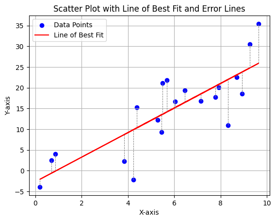

## Rough Schedule {.smaller}

:::: {.columns}
::: {.column width=80%}

| Time | Session |
|------|---------|
| 14:00–14:30 | Introduction to Neural Networks (David)|
| 14:30–15:30 | Classification Using Tabular Data (Isaac)|

TODO: Is this necessary?

:::
::::

## Material {.smaller}

These slides can be viewed at:

- [https://cambridge-iccs.github.io/practical-ml-with-pytorch TODO](https://cambridge-iccs.github.io/practical-ml-with-pytorch)  

The html and source can be found [on GitHub](https://github.com/Cambridge-ICCS/practical-ml-with-pytorch). Follow this link:

- [https://tinyurl.com/ml-iccs-24](https://tinyurl.com/ml-iccs-24)

\
\
Based on the workshop developed by [Jack Atkinson](https://orcid.org/0000-0001-5001-4812) and [Jim Denholm](https://orcid.org/0000-0002-2389-3134):

  - [github.com/Cambridge-ICCS/practical-ml-with-pytorch](https://github.com/Cambridge-ICCS/practical-ml-with-pytorch)
  - [LICENSE](https://github.com/Cambridge-ICCS/practical-ml-with-pytorch/blob/main/LICENSE)

V1.0 released and JOSE paper accepted: 

  - [@atkinson2024practical]

## Learning objectives {.smaller}
The key learning objective from this workshop could be simply summarised as:
*Provide the ability to develop ML models in PyTorch.*

Specifically: 

- provide an understanding of the structure of a PyTorch model and ML pipeline,
- introduce the different functionalities PyTorch might provide, and
- exercise careful consideration and understanding of data used for training ML models.

\
\
With regards to specific ML content, we cover:

- using ML for classification problems,
- TODO: maybe more specific within classification problem

<!--
## NCAS School (rough) Schedule {.smaller}

:::: {.columns}
::: {.column width=50%}
AM session - Fitzwilliam College

* 9:00-9:30 - ML lecture
* 9:30-10:30 - Teaching/Code-along
* 10:30-11:00 - Coffee
* 11:00-12:00 - Teaching/Code-along
* 12:00-12:30 - CNN Lecture

Lunch

* 12:30 - 13:30
:::

::: {.column width=50%}
PM session - Computer Lab

* 13:30-15:30 - CNN exercise in groups
* 15:30-16:00 - Tea, `GOTO SS03`
* 16:00-16:15 - CNN Solution recap
* 16:15-17:00 - Climate applications of ML

::: {style="color: turquoise;"}
Helping Today:

* Jack Atkinson - ICCS Climate RSE
* Dominic Orchard - Kent/Cambridge CompSci
* Matt Archery - Cambridge RSE
:::
:::
::::
-->

# Part 1: Neural-network basics -- and fun applications.


## Stochastic gradient descent (SGD)

- Generally speaking, most neural networks are fit/trained using SGD (or some variant of it).
- To understand how one might fit a function with SGD, let's start with a straight line: $$f(x)=mx+c$$

## Fitting a straight line with SGD I {.smaller}

- Suppose we have some observed data points, each consisting of an input $x_i$ and a corresponding target $y_i$: $\{x_i, y_i\}$

- Our model predicts:
$$
\widehat{y}_{i}=f(x_i)=mx_i+c
$$

- We can measure the distance between our model $\widehat{y}_{i}$ and the data points $y_{i}$: 
$$e = |\widehat{y}_i - y_{i}|$$

- $e$ depends on the model parameters $m$ and $c$.

## Fitting a straight line with SGD II {.smaller}




- Goal is to find the optimal combination of $m$ and $c$ to **minimise the loss**.


<!-- :::: {.columns} -->
<!-- ::: {.column width="30%"} -->

<!-- - Consider the data:

| $x_{i}$  | $y_{i}$ |
|:--------:|:-------:|
| 1.0      | 2.1     |
| 2.0      | 3.9     |
| 3.0      | 6.2     | -->

## Fitting a straight line with SGD III {.smaller}


<!-- ::: {.column width="70%"} -->

- Normally we might consider the mean-squared error:

$$L_{\text{MSE}} = \frac{1}{n}\sum_{i=1}^{n}\left(y_{i} - \widehat{y}_{i}\right)^{2}$$

:::: {.columns}
::: {.column width="45%"}

- Model: \ $f(x) = mx + c$

- Data: \ $\{x_{i}, y_{i}\}$

- Loss: \ $\frac{1}{n}\sum_{i=1}^{n}(y_{i} - \widehat{y}_{i})^{2}$

:::

::: {.column width="55%"} 

- We can differentiate the loss function w.r.t. to each parameter in the the model $f$.
$$
\begin{align}
L_{\text{MSE}} &= \frac{1}{n}\sum_{i=1}^{n}(y_{i} - f(x_{i}))^{2}\\
    &= \frac{1}{n}\sum_{i=1}^{n}(y_{i} - mx_{i} + c)^{2}
\end{align}
$$
:::
::::


####

## Fitting a straight line with SGD VI {.smaller}

- With chain-rule:

$$
\frac{\partial L}{\partial m}
\;=\;
\frac{1}{n}\sum_{i=1}^{n} 2\bigl(m\,x_{i}+c-y_{i}\bigr)\,x_{i}.
$$

$$
\frac{\partial L}{\partial c}
\;=\;
\frac{1}{n}\sum_{i=1}^{n} 2\bigl(m\,x_{i}+c-y_{i}\bigr).
$$

- The gradient 
$\vec{\nabla} L = \begin{bmatrix} \frac{\partial L}{\partial m} \\ \frac{\partial L}{\partial c} \end{bmatrix}$
then points in the direction of _steepest ascent_.

- $-\vec{\nabla} L$ in the direction of _steepest descent_.


## Fitting a straight line with SGD V {.smaller}

- Assuming an initial guess for the model parameters 
$$\begin{bmatrix}
m_{0} \\
c_{0}
\end{bmatrix}
$$
- We can iteratively minimise the loss by stepping the model's parameters in the direction of steepest descent:

$$\begin{bmatrix}
m_{n+1} \\
c_{n+1}
\end{bmatrix} =
\begin{bmatrix}
m_{n} \\
c_{n}
\end{bmatrix} -
l_{r} \, \vec{\nabla}L_{n} = 
\begin{bmatrix}
m_{n} - l_{r}\frac{dL}{dm}|_{m_{n}, c_{n}}\\
c_{n} - l_{r}\frac{dL}{dc}|_{m_{n}, c_{n}}
\end{bmatrix}
$$

- where $l_{\text{r}}$ is a small constant known as the _learning rate_.


## Quick recap {.smaller}

To fit a model we need:

- Some^[Well, a suitable amount of - often a lot.] data.
- A model.
- A loss function.
- An optimisation procedure (often SGD and other flavours of SGD).

::: {.fragment .fade-in}
To evaluate how well our model performs, we can split our data into **training** and **validation** sets.
:::


## What about neural networks? {.smaller}

- Neural networks are just functions (usually with many parameters).
- We can "train", or "fit", them as we would any other function:
  - by iteratively nudging parameters to minimise a loss.
- With neural networks, differentiating the loss function is a bit more complicated
  - but ultimately it's just the chain rule.
- We won't go through any more maths on the matter---learning resources on the topic are in no short supply.^[The term to search for is ['backpropogation'](https://en.wikipedia.org/wiki/Backpropagation).]


## Fully-connected neural networks {.smaller}

- The simplest neural networks commonly used are generally called fully-connected neural nets, dense networks, multi-layer perceptrons, or artifical neural networks (ANNs).

:::: {.columns}
::: {.column width=50%}

- We map between the features at consecutive layers through matrix multiplication (weights $W_{l}$ and bias $b_{l}$) and the application of some non-linear activation function ($\sigma$).

$$a_{l+1} = \sigma \left( W_{l}a_{l} + b_{l} \right)$$

- For common choices of activation function, see the [PyTorch](https://pytorch.org/docs/stable/nn.html#non-linear-activations-weighted-sum-nonlinearity) docs.

:::
::::

{style="border-radius: 40%;" .absolute top=35% left=55% width=55%}

::: {.attribution}
Image source: [3Blue1Brown](https://www.3blue1brown.com/topics/neural-networks)
:::


## Uses: Classification and Regression {.smaller}

- Fully-connected neural networks are often applied to tabular data.
  - i.e. where it makes sense to express the data in a table-like object (such as a `pandas` data frame).
  - The input features and targets are represented as vectors.

::: {.fragment .fade-in}
- Neural networks are normally used for one of two things:
  - **Classification**: assigning a semantic label to something -- i.e. is this a dog or cat?
  - **Regression**: Estimating a continuous quantity -- e.g. mass or volume -- based on other information.
:::


# Python and PyTorch {.smaller}

- In this workshop, we will implement some straightforward neural networks in PyTorch, and use them for a classification problem.
- PyTorch is a deep learning framework that can be used in both Python and C++.
- There are other frameworks like Jax, Tensorflow, PyTorch Lightning
- See the PyTorch website: [https://pytorch.org/](https://pytorch.org/)
- TODO: Should we still point to full course if people want to have a look at other problems

# Datasets, DataLoaders & `nn.Module`


---

## What a `Dataset` class does

- Provides a **uniform API** to your data
- Handles
  - **Loading** raw files (images, CSVs, audio …)
  - **Train / validation / test** split logic
  - **Transforms / augmentation** per item
  - **Item retrieval** so the rest of PyTorch can stay agnostic

---

## Anatomy of a custom `Dataset`

```python
class MyDataset(torch.utils.data.Dataset):
    def __init__(self, root_dir, split="train", transform=None):
        # 1️ load or download files / labels
        self.paths, self.labels = load_index_file(root_dir, split)
        self.transform = transform  # 2️ save transforms
```

*The constructor is where you gather file paths, download archives, read CSVs, etc.*

---

## `__len__` & `__getitem__`

```python
    def __len__(self):
        return len(self.paths)      # total #samples

    def __getitem__(self, idx):
        img = PIL.Image.open(self.paths[idx]).convert("RGB")
        if self.transform:          # 3️ apply transforms
            img = self.transform(img)
        label = self.labels[idx]
        return img, label           # 4️ single example
```

With these two methods PyTorch knows **how big** the dataset is and **how to fetch** one record.

---

## Using the custom dataset

```python
from torchvision import transforms

train_ds = MyDataset(
    "data/cats_vs_dogs",
    split="train",
    transform=transforms.ToTensor()
)
print(len(train_ds))   # e.g. ➜ 20_000
img, y = train_ds[0]   # one (tensor, label) pair
```

---

## The **DataLoader** at a glance

- Wraps any `Dataset` in an **iterable**
- **Batches** samples together (TODO: mainly important for GPU performance?)
- **Shuffles** if asked
- Uses **multiprocessing** (`num_workers`) to pre‑fetch data in parallel
- Returns `(batch, labels)` tuples ready for the GPU

---

## Typical DataLoader code

```python
train_loader = torch.utils.data.DataLoader(
    dataset=train_ds,
    batch_size=64,
    shuffle=True,
    num_workers=4,      # 4 CPU workers
)

for images, labels in train_loader:
    ...
```


---

## Quick networks with `nn.Sequential`

```python
mlp = torch.nn.Sequential(
    torch.nn.Linear(784, 256), torch.nn.ReLU(),
    torch.nn.Linear(256, 64),  torch.nn.ReLU(),
    torch.nn.Linear(64, 10)
)

out = mlp(torch.rand(32, 784))  # 32‑sample batch
```

Great for simple feed‑forward stacks when no branching logic is needed.

---

## `nn.Module` overview

- The **base class** for *all* neural‑network parts in PyTorch
- You **sub‑class**, then implement
  - `__init__(self)`: declare layers
  - `forward(self, x)`: define the forward pass

---

## Declaring layers in `__init__`

```python
class MyCNN(torch.nn.Module):
    def __init__(self, num_classes=2):
        super().__init__()
        self.features = torch.nn.Sequential(
            torch.nn.Conv2d(3, 32, 3, padding=1), torch.nn.ReLU(),
            torch.nn.MaxPool2d(2),
            torch.nn.Conv2d(32, 64, 3, padding=1), torch.nn.ReLU(),
            torch.nn.MaxPool2d(2)
        )
        self.classifier = torch.nn.Linear(64*56*56, num_classes)
```
TODO: this introduces CNNs, we want to keep or go back to quick NN example?

---

## The `forward` pass

```python
    def forward(self, x):
        x = self.features(x)   # conv stack
        x = x.flatten(1)       # N,…
        x = self.classifier(x) # logits
        return x
```

Only **forward** is needed – back‑prop is handled automatically.

---

## Calling the model ≈ calling `forward`

```python
model = MyCNN()
logits1 = model(images)          # preferred ✔
logits2 = model.forward(images)  # works, but avoid
```
TODO: why avoid?

`model(input)` internally routes to `model.forward(input)` via `__call__`.

---

## Key Take‑Aways

1. **Dataset** = organized access to *individual* samples
2. **DataLoader** = batching, shuffling, parallel I/O
3. `nn.Module` = reusable building block; override `__init__` & `forward`
4. `model(x)` is the idiomatic way to run a forward pass
5. Use `nn.Sequential` for quick layer chains


# Exercises


## Penguins!

<!---->


::: {.attribution}
Image source: [Palmer Penguins by Alison Horst](https://allisonhorst.github.io/palmerpenguins)
:::

## Exercise 1 -- classification

- In this exercise, you will train a fully-connected neural network to [*classify the species*]{style="text-decoration: underline;"} of penguins based on certain physical features.
- [https://github.com/allisonhorst/palmerpenguins](https://github.com/allisonhorst/palmerpenguins)

<!-- # Further information -->

<!-- ## Slides

These slides can be viewed at:  
[https://cambridge-iccs.github.io/practical-ml-with-pytorch](https://cambridge-iccs.github.io/practical-ml-with-pytorch)  

The html and source can be found [on GitHub](https://github.com/Cambridge-ICCS/practical-ml-with-pytorch). -->


## Contact {.smaller}

For more information we can be reached at:

:::: {.columns style="font-size: 60%"}
::: {.column width="25%"}

 \ Isaac Akanho

 \ [ICCS/UoCambridge](https://iccs.cam.ac.uk/about-us/our-team)

 \ [ia464[AT]cam.ac.uk](mailto:ia464@cam.ac.uk)

 \ [isaacaka](https://github.com/isaacaka)

:::

::: {.column width="25%"}

 \ David Kamm

 \ [ICCS/UoCambridge](https://iccs.cam.ac.uk/about-us/our-team)

 \ [dk789[AT]cam.ac.uk](mailto:dk789@cam.ac.uk)

 \ [vopikamm](https://github.com/vopikamm)

:::

<!-- ::: {.column width="25%"}

 \ Joe Wallwork

 \ [ICCS/UoCambridge](https://iccs.cam.ac.uk/about-us/our-team)

 \ [jw2423[AT]cam.ac.uk](mailto:jw2423@cam.ac.uk)

 \ [jwallwork23](https://github.com/jwallwork23)

::: -->

::: {.column width="25%"}

 \ Jack Atkinson

 \ [ICCS/UoCambridge](https://iccs.cam.ac.uk/about-us/our-team)

 \ [jackatkinson.net](https://jackatkinson.net)

 \ [jwa34[AT]cam.ac.uk](mailto:jwa34@cam.ac.uk)

 \ [jatkinson1000](https://github.com/jatkinson1000)

 \ [\@jatkinson1000\@fosstodon.org](https://hachyderm.io/@jatkinson1000)

:::

::: {.column width="25%"}

 \ Jim Denholm

 \ UoCambridge

 \ [linkedin](https://uk.linkedin.com/in/jim-denholm-13043b189)

 \ [jd949[AT]cam.ac.uk](mailto:jd949@cam.ac.uk)

 \ [jdenholm](https://github.com/jdenholm)

:::
::::

<!-- You can also contact the ICCS, [make a resource allocation request](https://iccs.cam.ac.uk/resources-vesri-members/resource-allocation-process), or visit us at the [Summer School RSE Helpdesk](https://docs.google.com/spreadsheets/d/1WKZxp3nqpXrIRMRkfFzc71sos-UD-Uy1zeab0c1p7Xc/edit#gid=0). -->
